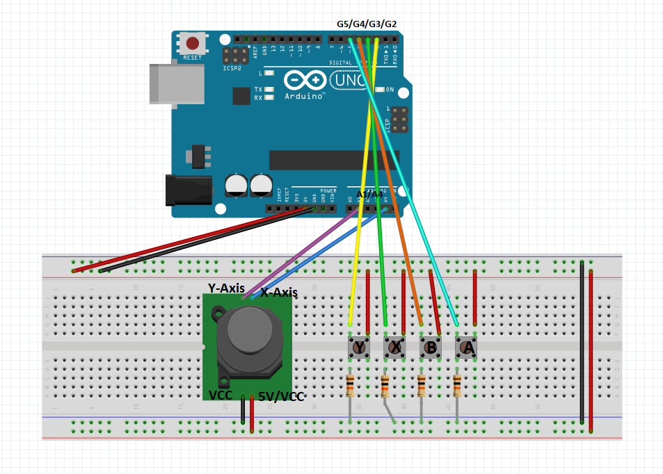

# Arduino USB Game Controller

## About The Project

This project turns an Arduino Uno into a USB game controller using an analog joystick and four push buttons.

The Arduino reads the joystick position and button states, then sends the data to a Python program over a serial connection. Python uses `vgamepad` to emulate an Xbox 360 controller on Windows.

The virtual controller can then be used with compatible games and emulators like 3DS or DS emulators.

### Circuit Diagram

Here is the circuit diagram : 



### Built With
- Arduino UNO
- [![Python][python-shield]][python-url]
- [pySerial](https://pyserial.readthedocs.io/)
- [vgamepad](https://github.com/yannbouteiller/vgamepad)
- [ViGEmBus](https://github.com/ViGEm/ViGEmBus)

---

## Getting Started

### Requirements

Before installing the project, make sure you have:

- An Arduino Uno.
- An analog joystick module.
- Four push buttons.
- Four 10k Ohms resistors.
- A breadboard and jumper wires.
- A Windows computer.
- Python 3.12 or a compatible Python version.
- The Arduino IDE.
- ViGEmBus installed on Windows. Click here to install -> https://github.com/ViGEm/ViGEmBus

### Hardware Installation

Build the circuit according to the diagram above.

#### Joystick Connections

| Joystick pin | Arduino Uno |
| ------------ | ----------- |
| VCC          | 5V          |
| GND          | GND         |
| VRx / HORZ   | A4          |
| VRy / VERT   | A1          |

#### Button Connections

| Button | Arduino pin |
| ------ | ----------- |
| X      | D2          |
| Y      | D3          |
| B      | D4          |
| A      | D5          |

Each button uses a 10k Ohms pull-down resistor connected between its digital input and GND. The button connects the same input to 5V when pressed.

**Important:** The wiring and Arduino code must use the same pull-down configuration. In this configuration, the code should use `INPUT`, and a pressed button should be read as `HIGH`.

### Software Installation

#### 1. Upload the Arduino program

1. Install and open the Arduino IDE.
2. Connect the Arduino Uno to your computer using USB.
3. Open the Arduino sketch (`.ino` file).
4. Select **Arduino Uno** under Tools -> Board.
5. Select the correct serial port under Tools ? Port.
6. Upload the sketch to the Arduino.

The Arduino sends six comma-separated values at 115200 baud:

`X,Y,buttonX,buttonY,buttonB,buttonA`

The first two values represent the joysticks analog readings. The remaining values represent the four buttons.

#### 2. Install Python dependencies

Open a terminal in the folder containing your Python program and run:

```bash
python -m pip install pyserial vgamepad
```

Make sure ViGEmBus is installed and working before starting the Python controller program.

#### 3. Configure the serial port

Open `main.py` and check the following settings:

```python
PORT = "COM9"
BAUDRATE = 115200
```

Replace `COM9` with the serial port assigned to your Arduino if necessary.

The baud rate must match the value used by the Arduino sketch.

#### 4. Start the virtual controller

Run the Python program from the terminal:

```bash
python main.py
```

If everything is configured correctly, the program should connect to the Arduino and activate the virtual Xbox 360 controller.

**Important:** Close the Arduino IDE Serial Monitor before launching the Python program, because both programs cannot normally use the same serial port simultaneously.

---

## Usage

1. Connect the Arduino to your computer.
2. Start `main.py`.
3. Move the joystick to control the analog stick.
4. Press X, Y, B or A to send the corresponding controller input.
5. Configure the virtual Xbox 360 controller in your game or emulator.

To stop the Python program, press `Ctrl+C` in the terminal.

The program should reset the virtual controller and close the serial connection when it exits.

---


## License

Distributed under the GNU License. See `LICENSE.txt` for more information.

---

## Contact

Hugo Gibert

Project Link: [https://github.com/lock94656/arduino_controller
](https://github.com/lock9456/arduino_controller)


<!-- MARKDOWN LINKS & IMAGES -->
<!-- https://www.markdownguide.org/basic-syntax/#reference-style-links -->

[python-shield]: https://img.shields.io/badge/Python-3776AB?style=for-the-badge&logo=python&logoColor=white
[python-url]: https://www.python.org/

[contributors-url]: https://github.com/lock94656/arduino_controller/graphs/contributors
[forks-url]: https://github.com/lock94656/arduino_controller/network/members
[stars-shield]: https://img.shields.io/github/stars/lock94656/arduino_controller.svg?style=for-the-badge
[stars-url]: https://github.com/lock94656/arduino_controller/stargazers
[issues-shield]: https://img.shields.io/github/issues/lock94656/arduino_controller.svg?style=for-the-badge
[issues-url]: https://github.com/lock94656/arduino_controller/issues
[license-shield]: https://img.shields.io/github/license/lock94656/arduino_controller.svg?style=for-the-badge
[license-url]: https://github.com/lock94656/arduino_controller/blob/master/LICENSE.txt

